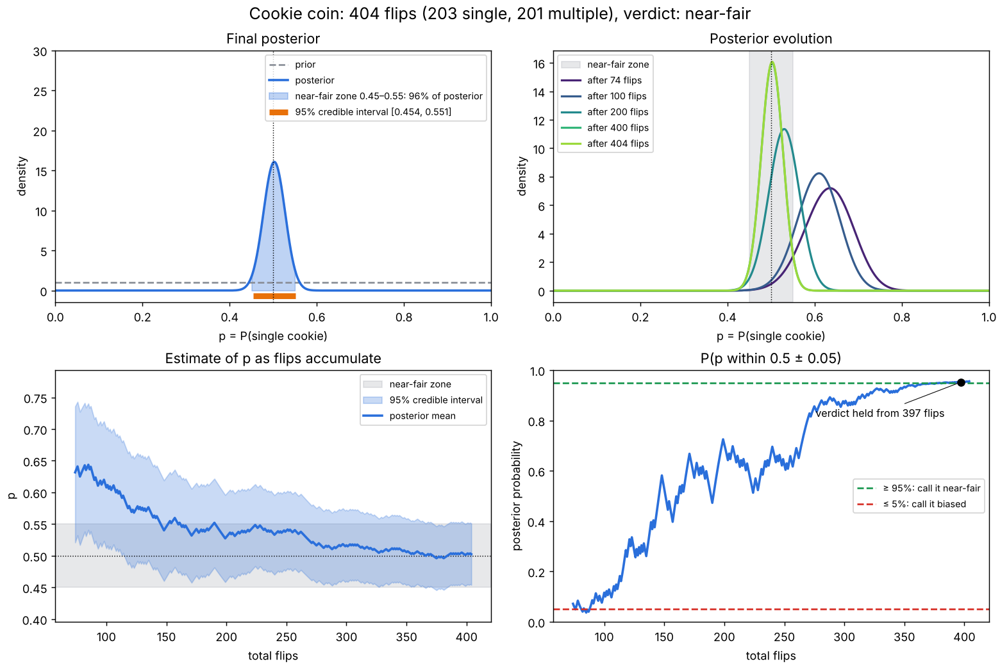

# coin-bayes

A basic tool which takes a Bayesian approach to determining the fairness of a coin. A series of coin flips can be
entered as single-key inputs for a custom 3D printed cookie coin. One one side, there is an image of a single cookie
(for which you hit `s`) and on the other multiple cookies (for which you hit `m`). After each flip, the model updates
belief. Specifically, it updates the belief that $p = P(\text{side A})$. Once the belief is tight enough, a verdict
is decided, and the program will inform the user about it's prediction. This process is not fully predictable, but 
will take approximately 400 flips with default settings. 

_Disclaimer:_ This database was largely generated using Claude Code (Opus 5.5). Code was checked, 
particularly the statistical model, by hand. Documentation was largely written by hand.

## Setup

This code base has relatively simple requirements. For ease of use, an environment file is provided. This environment
can be setup using either `conda` or `mamba`. If either of those are setup, there are no other requirements, the rest is
handled by the environment. To begin, setup the environment with the following commands.

```bash
mamba env create -f environment.yml
mamba activate coin-bayes
```

## Use

This program uses a TUI interface. It can be initialized with flips using the `--init` flag if flips have already been 
counted. Alternatively, it can be started in the default state. Flips will be saved as `coin_flips.txt`. Note that this file
carries over between sessions so should be deleted or moved if testing another coin. By default, the program tries to estimate
a credible interval of 95% and will make a verdict when the coin is fair within ± 5%. This can be adjusted with `--rope`. 
The commands below are several examples of how to launch the program.

```bash
python3 main.py                  # fresh start, or resume from coin_flips.txt
python3 main.py --init 47 27     # start from earlier counts (single, multiple)
python3 main.py --rope 0.10      # near-fair zone = 0.5 ± 0.10
```

Once the program has startedm, simply flip the coin and push either `s` if it landed on the single-cookie side or `m` if it landed
on the multiple-cookie side and repeat until a verdict is called. If you make a mistake, push `u` to undo. When you are done, push
`q` to quit. Flips are saved to `coin_flips.txt`. 

A visualization is show of the approximate probability distribution and the "fairness zone" (_i.e.,_ where the probability should lie
to be considered fair). Once the final verdict is achieved, an image will be saved in `plots/` with several plots indicating how the
distribution changed with the flips and what the final result looks like. These are saved as a single `.png` file.

## What it computes

To determine if a coin is fair, the following statistics are used. Here, `p` is the probability that the single-cookie side is flipped
(and the probability that the multiple-cookie side is flipped is simply given by `p - 1`). 

- Prior: `Beta(1, 1)`, a flat distribution, `p` is equally likely to be anything from 0% to 100% (can be changed with `--prior`)
- Posterior: `Beta(prior + singles, prior + multiples)`, each flip adds one to the respective count
- **Near-fair zone:** the range of values for which `p`is considered "fair", by default this is 50±5% (_i.e.,_ `0.5±0.05`)
- **Verdict:** once the posterior probability of the zone is within the desired confidence (95% by default, can be specified with `--conf`), a verdict is determined about whether or not the coin is fair. Keep flipping until a verdict is determined. By default, there must be at least 30 flips (can be changed with `--min-flips`) to prevent an unlikely string of flips moving the distribution outside of the fairness zone completely. 

## Plots

Saved to `plots/` and opened in a window when a verdict is first reached and again when you quit (`--no-show` saves without opening a window):

1. **Final posterior:** density for p, with the prior, the near-fair zone, and the 95% credible interval.
2. **Posterior evolution:** the density after a few checkpoints (10, 25, 50, 100 … flips).
3. **Estimate over flips:** posterior mean and 95% credible interval after every flip.
4. **P(near-fair) over flips:** with the 95% / 5% decision thresholds and where the verdict was reached.



*Example from simulated flips of a fair coin*

## Layout

```
main.py               entry point and command-line options
coin_bayes/
  model.py            the Beta-Binomial maths (no printing or plotting)
  ui.py               one-keystroke input and the text screen
  plots.py            the four plots
  session.py          the flip loop, log file, and when plots are triggered
tests/test_model.py   checks for the maths
```

Run the tests with `python -m pytest`.

## A word of advice

When using a coin for chance, the coin itself is only part of the question. How a person flips a coin also has an impact. For example, if you always
take the coin with the single-cookie side face up, and you flip it so low that it only has time to flip once, then you will almost always get the 
multiple-cookie side. This means you should think a little about how you flip. The biggest factor is to make sure you flip high enough that the coin 
has time to flip in the air multiple times. Additionally, try to not bias how you initially hold the coin, such as by always having the same side
up. Instead try to mix it up (but again, careful to be random about this to not bias it towards the result you want). Then, let the statistics do the
work for you! If it ends up in the fairness zone, then the coin and your habits are enought to make everything fair!
