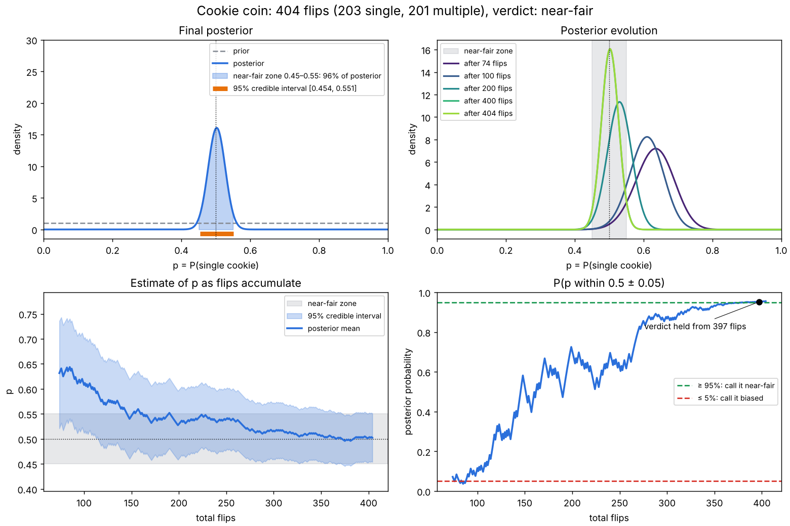

# coin-bayes

A terminal tool for checking whether a coin is fair, using Bayesian updating. Flip the coin, press one key for the side it landed on, and watch the belief about p = P(side A) tighten. It was written for a 3D-printed cookie coin (single cookie vs multiple cookies), but the sides are just labels.

## Setup

```bash
mamba env create -f environment.yml
mamba activate coin-bayes
```

Only `scipy` and `matplotlib` are needed (`pytest` is for the tests).

## Use

```bash
python3 main.py                  # fresh start, or resume from coin_flips.txt
python3 main.py --init 47 27     # start from earlier counts (single, multiple)
python3 main.py --rope 0.10      # near-fair zone = 0.5 ± 0.10
```

Keys: `s` single cookie, `m` multiple cookies, `u` undo, `q` quit. Every flip is saved to `coin_flips.txt` straight away, so you can stop and resume.

## What it computes

- Prior: `Beta(1, 1)` (flat; change with `--prior`). Each flip adds 1 to the matching count, so the posterior is `Beta(prior + singles, prior + multiples)`.
- **Near-fair zone:** p within 0.5 ± `--rope` (default 0.05).
- **Verdict:** once the posterior probability of the zone reaches `--conf` (default 95%) it says the coin is close enough to fair. If it falls to 5% or below, it says the coin looks biased. In between, keep flipping. No verdict is given before `--min-flips` total flips (default 30), because with a flat prior a handful of identical flips already puts most of the posterior outside the zone.

## Plots

Saved to `plots/` and opened in a window when a verdict is first reached and again when you quit (`--no-show` saves without opening a window):

1. **Final posterior:** density for p, with the prior, the near-fair zone, and the 95% credible interval.
2. **Posterior evolution:** the density after a few checkpoints (10, 25, 50, 100 … flips).
3. **Estimate over flips:** posterior mean and 95% credible interval after every flip.
4. **P(near-fair) over flips:** with the 95% / 5% decision thresholds and where the verdict was reached.



*Example from simulated flips of a fair coin, started from 47 single / 27 multiple.*

## Layout

```
main.py               entry point and command-line options
coin_bayes/
  model.py            the Beta-Binomial maths (no printing or plotting)
  ui.py               one-keystroke input and the text screen
  plots.py            the four plots
  session.py          the flip loop, log file, and when plots are triggered
tests/test_model.py   checks for the maths
```

Run the tests with `python -m pytest`.

## Tip

Alternate which side starts face-up and flip high onto a hard surface. A habit in how you flip can bias the result far more than the coin does.
